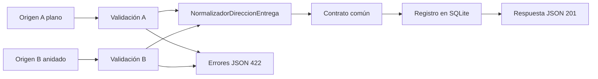

# Práctica individual de traducción y normalización de direcciones de entrega

## Proceso y alcance

**Estudiante:** Maykel Menendez. **Proceso:** registrar una dirección de entrega para pedidos a domicilio. **Actores de referencia:** pantalla móvil de direcciones, checkout móvil y API. **Objetivo:** traducir dos estructuras de entrada a un contrato JSON plano común.

Esta es una adaptación educativa independiente del sistema de restaurante. En el proyecto de aula, ambos flujos móviles envían finalmente un JSON plano al backend Java. El checkout, antes del envío, mantiene por separado los campos de dirección y un objeto de ubicación. Esta práctica usa ese estado interno como un segundo formato JSON de entrada; **no afirma que el backend Java tenga una ruta anidada**. Aquí tampoco se implementan autenticación ni `clienteId`.

## Archivos de entrega

El traductor está en `app/Services/NormalizadorDireccionEntrega.php`. `app/Http/Requests/StoreDireccionEntregaRequest.php` valida el origen plano y `app/Http/Requests/StoreDireccionCheckoutRequest.php` valida el origen anidado. `app/Http/Controllers/Api/DireccionEntregaController.php` integra ambos formatos con el registro existente; `routes/api.php` declara las rutas. Ambos orígenes usan el mismo modelo `DireccionEntrega` y el mismo `DireccionEntregaResource`.

`tests/Feature/NormalizarDireccionEntregaTest.php` verifica P1, P2, P3 y otros errores. Este README contiene los cuerpos JSON ficticios para Postman, el mapeo, el diagrama, las instrucciones y los resultados de la práctica.

### Referencia del flujo del proyecto de aula

La pantalla móvil «Direcciones» construye campos planos de texto y puede enviar `observaciones`; normalmente no captura coordenadas. El checkout reúne un formulario `direccion` y una `ubicacion` con `latitude` y `longitude`; antes de llamar a la API real los aplana como `lat` y `lng`. Para P1 se envían coordenadas en el formato plano que el contrato del backend admite, aunque la pantalla «Direcciones» no las envíe actualmente. Así P1 y P2 representan exactamente la misma dirección.

| Diferencia | Origen A plano | Origen B anidado de esta práctica |
| --- | --- | --- |
| Estructura | Campos en la raíz | Campos bajo `direccion` y `ubicacion` |
| Nombres de coordenadas | `lat` y `lng` | `latitude` y `longitude` |
| Datos disponibles | Puede incluir `observaciones`; coordenadas opcionales | Puede incluir `referencia`; requiere ambas coordenadas |

`observaciones` y `referencia` no son sinónimos. Se conservan como campos distintos para evitar perder o inventar información.

## Contrato de solicitud

Envía `Content-Type: application/json` y `Accept: application/json`. El origen A usa `POST /api/v1/clientes/direcciones`, la ruta plana existente. El origen B usa `POST /api/v1/clientes/direcciones/checkout`, agregada solo a esta adaptación Laravel.

| Origen A plano | Origen B checkout | Contrato común | Regla de transformación y validación |
| --- | --- | --- | --- |
| `etiqueta` | `direccion.etiqueta` | `etiqueta` | Texto obligatorio no vacío; máximo 40 caracteres. |
| `direccion` | `direccion.direccion` | `direccion` | Texto obligatorio no vacío; máximo 200 caracteres. |
| `telefono` | `direccion.telefono` | `telefono` | Texto opcional; máximo 20 caracteres; sin conversión de formato. |
| `observaciones` | No disponible | `observaciones` | Texto opcional de A; máximo 200 caracteres; no derivar de `referencia`. |
| `referencia` | `direccion.referencia` | `referencia` | Texto opcional; máximo 200 caracteres. |
| `lat` | `ubicacion.latitude` | `lat` | Número JSON entre −90 y 90; no aceptar cadenas numéricas. |
| `lng` | `ubicacion.longitude` | `lng` | Número JSON entre −180 y 180; no aceptar cadenas numéricas. |

En A las coordenadas son opcionales. En B se requieren `direccion`, `ubicacion` y ambas coordenadas, como ocurre en el flujo de entrega del checkout. B rechaza claves no permitidas dentro de esos dos objetos. Los campos opcionales pueden omitirse o enviarse como `null`. El traductor devuelve siempre las siete claves `etiqueta`, `direccion`, `telefono`, `observaciones`, `referencia`, `lat` y `lng`, en ese orden; los opcionales ausentes quedan en `null`. `clienteId` nunca viene en el cuerpo: el sistema original lo obtiene de la autenticación, que aquí se omitió. El traductor conserva los números recibidos sin redondearlos silenciosamente.

P1, origen A plano:

```json
{"etiqueta":"Casa de prueba","direccion":"Calle Ficticia 123","telefono":"0990000000","referencia":"Frente al parque","lat":-0.9580285,"lng":-80.6384797}
```

P2, origen B anidado con el mismo significado:

```json
{"direccion":{"etiqueta":"Casa de prueba","direccion":"Calle Ficticia 123","telefono":"0990000000","referencia":"Frente al parque"},"ubicacion":{"latitude":-0.9580285,"longitude":-80.6384797}}
```

Los dos producen estos datos normalizados antes del registro:

```json
{"etiqueta":"Casa de prueba","direccion":"Calle Ficticia 123","telefono":"0990000000","observaciones":null,"referencia":"Frente al parque","lat":-0.9580285,"lng":-80.6384797}
```

## Contrato de respuesta

Una entrada válida registra la dirección y devuelve **HTTP 201 Created** con un objeto `data`. Este contiene `id` entero, `etiqueta` y `direccion` como textos, `telefono`, `observaciones` y `referencia` como textos o `null`, `lat` y `lng` como números o `null`, `activa` como booleano y `creadoAt` como fecha ISO 8601. P1 y P2 deben tener los mismos valores y tipos de dirección; `id` y `creadoAt` se generan por separado.

Una entrada inválida devuelve **HTTP 422** con `message` y `errors`, cuyas claves identifican los campos rechazados. P3 omite `direccion.etiqueta` y `ubicacion.longitude`, así que ambas claves aparecen en `errors` y no se guarda una fila. El texto del mensaje puede variar con el idioma configurado. Estos códigos pertenecen a la adaptación Laravel; el backend Java original responde con 200 al registrar y 400 ante errores de validación.

## Cómo ocurre el intercambio



`NormalizadorDireccionEntrega` tiene un método por origen: `desdeDirecciones()` y `desdeCheckout()`. Los Form Requests comprueban cada entrada antes de llamar al servicio. El controlador recibe los datos normalizados, usa una sola operación de guardado y devuelve el mismo API Resource. El mapeo está en el servicio para no dispersar nombres y estructura entre controladores.

## SQLite

El registro manual usa `database/database.sqlite`, sin servidor de base de datos. P1 y P2 crean una fila cada uno; P3 no crea ninguna. Las pruebas automatizadas usan SQLite en memoria (`:memory:`) y no modifican el archivo local.

## Preparación y arranque en PowerShell

Se requiere PHP 8.3 con `pdo_sqlite`, Composer y Postman. Desde la raíz de este repositorio, ejecuta:

```powershell
php -v
php -m | Select-String pdo_sqlite
composer -V
composer install
if (-not (Test-Path .env)) { Copy-Item .env.example .env; php artisan key:generate --no-interaction }
if (-not (Test-Path database/database.sqlite)) { New-Item database/database.sqlite -ItemType File | Out-Null }
```

En `.env`, deja `DB_CONNECTION=sqlite` y `DB_DATABASE` sin definir o comentado. Si `.env` ya existía y `APP_KEY` está vacío, ejecuta `php artisan key:generate --no-interaction`. No incluyas `.env` en la entrega.

```powershell
php artisan config:clear --no-interaction
php artisan migrate --no-interaction
php artisan serve --host=localhost --port=8000 --no-interaction
```

Deja abierta esa terminal mientras pruebas. Si el puerto 8000 está ocupado, usa otro en `--port` y cambia las URL de Postman.

## Pruebas manuales en Postman

En las tres solicitudes selecciona **POST** y **Authorization → No Auth**. En **Headers** agrega `Content-Type: application/json` y `Accept: application/json`. En **Body → raw → JSON**, pega el cuerpo correspondiente y pulsa **Send**.

**P1. Origen A plano.** URL: `http://localhost:8000/api/v1/clientes/direcciones`. Pega:

```json
{
  "etiqueta": "Casa de prueba",
  "direccion": "Calle Ficticia 123",
  "telefono": "0990000000",
  "referencia": "Frente al parque",
  "lat": -0.9580285,
  "lng": -80.6384797
}
```

Debe devolver **201 Created**, `data` con la dirección y una fila nueva.

**P2. Origen B anidado.** URL: `http://localhost:8000/api/v1/clientes/direcciones/checkout`. Pega:

```json
{
  "direccion": {
    "etiqueta": "Casa de prueba",
    "direccion": "Calle Ficticia 123",
    "telefono": "0990000000",
    "referencia": "Frente al parque"
  },
  "ubicacion": {
    "latitude": -0.9580285,
    "longitude": -80.6384797
  }
}
```

Debe devolver **201 Created** con los mismos campos y tipos de dirección que P1. `id` y `creadoAt` cambiarán porque se crea otra fila.

**P3. Entrada incompleta.** Usa la URL de P2 y pega:

```json
{
  "direccion": {
    "direccion": "Calle Ficticia 123"
  },
  "ubicacion": {
    "latitude": -0.2
  }
}
```

Debe devolver **422** con errores para `direccion.etiqueta` y `ubicacion.longitude`, sin crear una fila.

Conserva una captura por caso que muestre la URL, el cuerpo, el estado HTTP y la respuesta. Usa solo datos ficticios.

## Pruebas automatizadas

En otra terminal PowerShell, desde la raíz del repositorio, ejecuta:

```powershell
php artisan test --compact tests/Feature/NormalizarDireccionEntregaTest.php
php artisan test --compact
```

La primera orden verifica P1, P2, P3, el arreglo de siete claves devuelto directamente por el servicio, los opcionales ausentes, la separación entre `referencia` y `observaciones`, las coordenadas escritas como texto, los campos no permitidos y los rangos. La segunda comprueba también las prácticas anteriores. Ninguna modifica la base SQLite local.

## Resultados de las pruebas

| Caso | Entrada | Resultado observado |
| --- | --- | --- |
| P1 | JSON plano válido | 201, contrato común y dirección registrada. |
| P2 | JSON anidado equivalente | 201, mismos campos de dirección y tipos que P1. |
| P3 | Faltan `direccion.etiqueta` y `ubicacion.longitude` | 422, errores por ambos campos y ninguna fila nueva. |

La suite de esta práctica pasó **8 pruebas y 46 aserciones**; la suite completa pasó **18 pruebas y 122 aserciones**. La igualdad de P1 y P2 se comprueba sin comparar los valores generados `id` y `creadoAt`.

## Reflexión individual

El conflicto de integración era que la pantalla de direcciones representa la entrada con campos planos y el checkout mantiene internamente una estructura anidada para la misma dirección. Elegí un servicio con un método por origen y validación previa mediante Form Requests para mantener estable el contrato de almacenamiento y rechazar valores ambiguos. Verifiqué la decisión con P1 y P2 equivalentes, P3 inválido y pruebas que comprueban el estado JSON y la ausencia de nuevos registros tras los errores.
