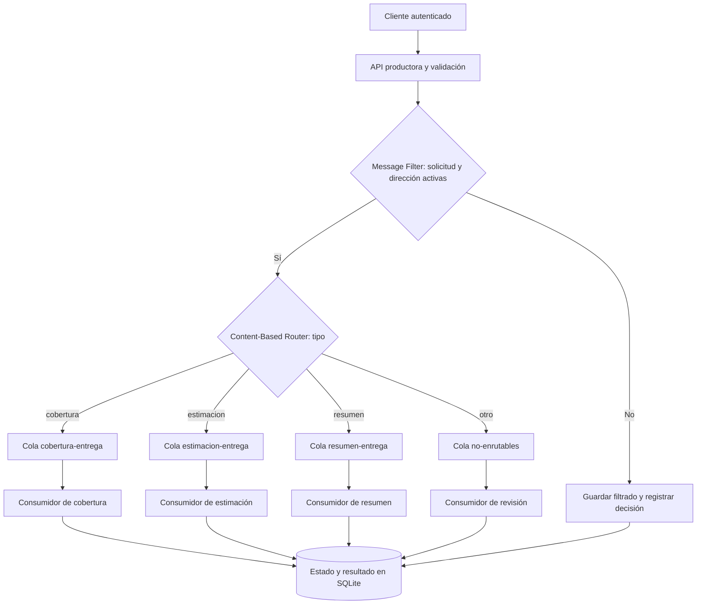

# Práctica individual 3.2 Enrutamiento y filtrado de mensajes de entrega

## Proceso del proyecto

El sistema de restaurante usa una dirección registrada para decidir si puede entregar un pedido, calcular una estimación y componer el resumen de ambos resultados. La práctica 3.1 introdujo una cola persistente para el resumen. Esta práctica agrega un productor de mensajes de entrega que inspecciona el **tipo** y envía cada mensaje al consumidor correspondiente. Antes de enrutar, un **Message Filter** impide procesar solicitudes canceladas o direcciones inactivas. Un tipo desconocido queda en una cola de revisión y nunca se descarta silenciosamente.

La conexión de Laravel es `database`: los trabajos se guardan realmente en la tabla `jobs` y un worker independiente los consume. No se instaló RabbitMQ; por tanto, no hay exchange ni routing keys de RabbitMQ. Las colas lógicas y las clases de job son los destinos reales de esta implementación.

| Tipo recibido | Regla de Content-Based Router | Cola | Consumidor y resultado |
| --- | --- | --- | --- |
| `cobertura` | Consultar disponibilidad para la dirección | `cobertura-entrega` | `ProcesarCoberturaEnrutada` consulta solo `/cobertura` |
| `estimacion` | Calcular tiempo y costo | `estimacion-entrega` | `ProcesarEstimacionEnrutada` consulta solo `/estimacion` |
| `resumen` | Componer ambos resultados | `resumen-entrega` | `ProcesarResumenEnrutado` consulta cobertura y estimación |
| Cualquier otro tipo válido | No existe consumidor de negocio para ese tipo | `no-enrutables` | `RevisarMensajeNoEnrutable` registra la revisión, sin consultar servicios |

**Filtro previo:** si `estado` del mensaje es `cancelada` o la dirección registrada tiene `activa = false`, se guarda la decisión `filtrado`, se registra en el log y no se crea trabajo en ninguna cola. Una solicitud filtrada responde **200** con `destino: null`; un tipo desconocido activo responde **202** con `destino: no-enrutables` y llega al consumidor de revisión. Son resultados de negocio, no errores de transporte. El campo `prioridad` (`normal` o `alta`) forma parte del contrato y queda registrado; **no modifica el orden de las colas** en esta práctica.

## Contrato y trazabilidad

`POST /api/v1/clientes/mensajes-entrega` requiere Bearer de Sanctum. El cliente envía `direccion_id` entero, `tipo` en minúsculas, `prioridad` y `estado` (`activa` o `cancelada`). La API comprueba que la dirección pertenece al usuario. El servidor genera `message_id` y conserva o genera `X-Correlation-ID`; no acepta que el cliente elija el identificador único del mensaje. La tabla `mensaje_entregas` almacena contenido, destino, estado de procesamiento y resultado, consultables por su propietario mediante `GET /api/v1/clientes/mensajes-entrega/{id}`.

```json
{"direccion_id":12,"tipo":"cobertura","prioridad":"normal","estado":"activa"}
```

Mensaje de dominio guardado en `mensaje_entregas.mensaje` y transportado como propiedad del job de Laravel:

```json
{
  "message_id": "UUID generado",
  "correlation_id": "ruta-cobertura-001",
  "tipo": "cobertura",
  "prioridad": "normal",
  "estado": "activa",
  "ocurrido_en": "fecha ISO 8601 generada",
  "datos": {"direccion_id": 12}
}
```

El mensaje no incluye token, nombre, dirección postal ni coordenadas. El worker lee la dirección autorizada desde SQLite. `message_id` distingue un mensaje de otro; `correlation_id` vincula la petición, la decisión de ruta, el consumidor, la llamada HTTP y los registros.



## Preparación reproducible

1. Instala dependencias con `composer install`. Prepara `.env` y SQLite como en `README_Tema_2_4.md`; usa `DB_CONNECTION=sqlite`, `QUEUE_CONNECTION=database` y `APP_DEBUG=false`. Ejecuta `php artisan migrate --no-interaction`. La migración nueva crea `mensaje_entregas`; la tabla `jobs` ya existía. No publiques `.env` ni tokens.
2. Sigue la guía 2.4 para crear el Cliente A y un token temporal. En Postman selecciona el entorno local y usa **Authorization → Bearer Token → `{{tokenA}}`** y `Accept: application/json`. El token caduca en una hora. Crea una dirección con coordenadas mediante `POST /api/v1/clientes/direcciones`, copia su `data.id` y sustitúyelo por `{direccion_id}` en los cuerpos de prueba. El propietario del token debe ser el propietario de la dirección.
3. Inicia cobertura, estimación y Laravel en tres terminales de la raíz del proyecto. Mantén el worker apagado hasta terminar los seis POST:

   ```powershell
   # Terminal 1
   Remove-Item Env:SERVICIO_MODO -ErrorAction SilentlyContinue
   $env:SERVICIO_TIPO='cobertura'; php -S 127.0.0.1:9001 servicios/router.php
   ```

   ```powershell
   # Terminal 2
   Remove-Item Env:SERVICIO_MODO -ErrorAction SilentlyContinue
   $env:SERVICIO_TIPO='estimacion'; php -S 127.0.0.1:9002 servicios/router.php
   ```

   ```powershell
   # Terminal 3
   php artisan serve --host=127.0.0.1 --port=8000 --no-interaction
   ```

## Seis casos manuales en Postman

Crea una petición **POST** a `http://127.0.0.1:8000/api/v1/clientes/mensajes-entrega`. En **Headers** agrega `Content-Type: application/json` y un `X-Correlation-ID` distinto por caso. En **Body → raw → JSON** usa la estructura siguiente, sustituyendo `{direccion_id}` por el ID real de tu dirección:

| Caso | `tipo` | `prioridad` | `estado` | `X-Correlation-ID` | Respuesta inicial |
| --- | --- | --- | --- | --- | --- |
| C1 | `cobertura` | `normal` | `activa` | `ruta-cobertura-001` | 202, destino `cobertura-entrega` |
| C2 | `estimacion` | `alta` | `activa` | `ruta-estimacion-001` | 202, destino `estimacion-entrega` |
| C3 | `resumen` | `normal` | `activa` | `ruta-resumen-001` | 202, destino `resumen-entrega` |
| C4 | `inventario` | `normal` | `activa` | `ruta-revision-001` | 202, destino `no-enrutables` |
| C5 | `cobertura` | `normal` | `cancelada` | `ruta-filtro-001` | 200, estado `filtrado`, destino `null` |
| C6 | Omitir `tipo` | `normal` | `activa` | `ruta-invalido-001` | 422, `errors.tipo` |

Para C1 a C5, el JSON contiene `direccion_id`, `tipo`, `prioridad` y `estado`; en C6 elimina **solo** la propiedad `tipo`. Guarda los `data.id` de C1 a C4: son IDs de mensaje, distintos del ID de la dirección. No repitas el POST para consultar un resultado.

Con el worker detenido, `php artisan queue:monitor database:cobertura-entrega,database:estimacion-entrega,database:resumen-entrega,database:no-enrutables --json --no-interaction` debe mostrar un trabajo en cada cola de C1 a C4. C5 y C6 no agregan trabajos.

En una cuarta terminal ejecuta:

```powershell
php artisan queue:work database --queue=cobertura-entrega,estimacion-entrega,resumen-entrega,no-enrutables --tries=3 --timeout=15 --stop-when-empty --no-interaction
```

Cuando vuelva el prompt, usa **GET** `http://127.0.0.1:8000/api/v1/clientes/mensajes-entrega/{id}` con `{{tokenA}}` para cada ID guardado. C1 debe mostrar `resultado.cobertura` y no `resultado.estimacion`; C2, solo `resultado.estimacion`; C3, ambos; C4, `estado: no_enrutable` y `resultado: null`. C5 permanece `filtrado`. Busca cada `correlation_id` en `storage/logs/laravel.log`: el productor registra la decisión y cada consumidor registra lo que recibió. En C4 aparece además el registro de revisión; en C5 solo la decisión de filtrado.

## Verificación automatizada y entrega

Ejecuta `php artisan test --compact tests/Feature/MensajeEntregaTest.php` para comprobar los tres destinos, la revisión de tipo desconocido, el filtro, la validación y el acceso. `php artisan test --compact` comprueba además que las prácticas anteriores siguen funcionando. Los tests usan SQLite en memoria y respuestas HTTP simuladas; los seis casos manuales anteriores verifican los procesos locales reales.

El informe individual debe incluir la tabla de reglas, el diagrama, capturas de C1 a C6 y una explicación breve de por qué **enrutar** elige un destino mientras **filtrar** impide que el mensaje llegue a cualquiera. No publiques el valor del Bearer ni datos confidenciales en capturas o documentos. El DOCX local de esta práctica contiene un espacio rotulado para cada evidencia; se exporta a PDF después de insertar las capturas reales.
