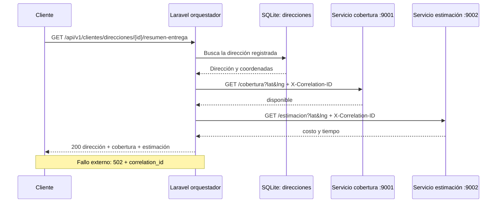

# Práctica 3.3 – Orquestación de un resumen de entrega

## Relación con el proyecto

Esta práctica continúa el registro y la normalización de direcciones de entrega de las prácticas 2.2 y 2.3. El cliente registra una dirección mediante `POST /api/v1/clientes/direcciones` o su variante `/checkout`. Después, `GET /api/v1/clientes/direcciones/{id}/resumen-entrega` recupera esa dirección de SQLite y consulta dos servicios de prueba: cobertura y estimación de costo y tiempo. Laravel compone la respuesta y mantiene un `X-Correlation-ID` común en la petición, las consultas externas, la respuesta y los logs.

Los servicios usan reglas **simuladas** para demostrar la integración; no representan cobertura, precios ni tiempos reales del restaurante. No se inventan pedidos ni estados de pedidos, porque este repositorio todavía no los implementa.

## Componentes y contrato

| Componente | Función |
| --- | --- |
| `app/Models/DireccionEntrega.php` | Recupera la dirección registrada en las prácticas anteriores. |
| `app/Http/Controllers/Api/ResumenEntregaController.php` | Consulta ambos servicios con timeout de 3 segundos y compone el resumen. |
| `app/Http/Middleware/AsegurarCorrelationId.php` | Propaga o genera `X-Correlation-ID` y lo incorpora al contexto de logs. |
| `servicios/router.php` | Simula cobertura en el puerto 9001 y estimación en el 9002, como procesos independientes. |
| `config/services.php` | Configura `SERVICIO_COBERTURA_URL` y `SERVICIO_ESTIMACION_URL`. |
| `tests/Feature/ResumenEntregaTest.php` | Comprueba la integración y los casos de error con servicios simulados. |

La dirección debe existir y tener `lat` y `lng`. Una dirección inexistente devuelve **404**; una dirección sin coordenadas devuelve **422** sin consultar los servicios. Si alguno no responde, devuelve HTTP 500 o entrega datos incompletos, el orquestador devuelve **502** con un mensaje controlado y el `correlation_id`. El detalle técnico queda solo en el log.

Una consulta correcta devuelve **200** con `data.direccion` (el mismo contrato de `DireccionEntregaResource`), `data.cobertura.disponible`, `data.estimacion` y `data.correlation_id`. Cuando no hay cobertura, `data.estimacion` es `null`, aunque ambos servicios hayan sido consultados.

## Ejecutar y probar en Postman

Desde la raíz del repositorio, configura `.env` con `DB_CONNECTION=sqlite` y ejecuta las migraciones si todavía no lo hiciste:

```powershell
php artisan migrate --no-interaction
```

Abre tres terminales independientes:

```powershell
# Terminal 1: servicio de cobertura
$env:SERVICIO_TIPO='cobertura'; php -S 127.0.0.1:9001 servicios/router.php
```

```powershell
# Terminal 2: servicio de estimación
$env:SERVICIO_TIPO='estimacion'; php -S 127.0.0.1:9002 servicios/router.php
```

```powershell
# Terminal 3: orquestador Laravel
php artisan serve --host=127.0.0.1 --port=8000 --no-interaction
```

En Postman, crea primero una dirección con **POST** `http://127.0.0.1:8000/api/v1/clientes/direcciones`, `Content-Type: application/json` y este cuerpo:

```json
{"etiqueta":"Casa de prueba","direccion":"Calle Ficticia 123","lat":-0.9580285,"lng":-80.6384797}
```

La respuesta es **201**. Copia `data.id` y úsalo en **GET** `http://127.0.0.1:8000/api/v1/clientes/direcciones/{id}/resumen-entrega`. Envía `X-Correlation-ID: entrega-001` para seguir la misma petición entre procesos. Debes recibir **200**, `data.cobertura.disponible: true`, `data.estimacion.costo_estimado: 2.5`, `data.estimacion.tiempo_minutos: 30` y `data.correlation_id: entrega-001`. La respuesta también incluye la cabecera `X-Correlation-ID`.

La cobertura simulada considera disponible el rectángulo de latitud −1.1 a −0.8 y longitud −80.8 a −80.5. La estimación simulada usa costo 2.5 y 30 minutos en la zona central; fuera de ella usa 4.0 y 45 minutos. Estos valores son únicamente datos de demostración.

## Casos de error y trazabilidad

1. **404:** consulta un ID de dirección inexistente.
2. **422:** registra una dirección sin coordenadas y consulta su resumen.
3. **502 por servicio caído:** detén la terminal de estimación y repite el GET. Comprueba que el JSON no contiene `trace`, `exception`, `file` ni `line`.
4. **502 por HTTP 500:** reinicia solo la terminal de estimación con `$env:SERVICIO_TIPO='estimacion'; $env:SERVICIO_MODO='error'; php -S 127.0.0.1:9002 servicios/router.php`.
5. **502 por timeout:** reinicia esa terminal con `SERVICIO_MODO='lento'`; el servicio espera 5 segundos y Laravel corta la espera a los 3 segundos.
6. **Logs:** busca el mismo `correlation_id` en las terminales de ambos servicios y en `storage/logs/laravel.log` para el fallo. El cliente solo recibe el mensaje controlado.

Para una demostración, guarda capturas del POST 201, del resumen 200, de un error 502 y del log con el mismo `correlation_id`.

## Pruebas automatizadas

```powershell
php artisan test --compact tests/Feature/ResumenEntregaTest.php
```

Las pruebas usan SQLite en memoria y `Http::fake()`: no modifican la base local ni requieren levantar los servicios de prueba.

## Secuencia


