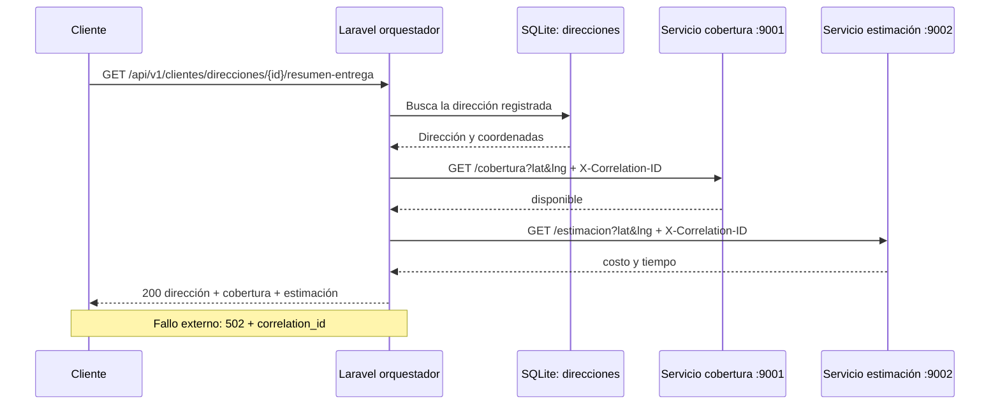

# Práctica 3.3 – Orquestación de un resumen de entrega

En el estado actual del proyecto, el POST de direcciones y el GET del resumen requieren el token Bearer del mismo cliente. Genera una dirección nueva con ese token según `README_Tema_2_4.md`; las direcciones anteriores sin propietario devuelven 403.

## Relación con el proyecto

Esta práctica continúa el registro y la normalización de direcciones de entrega de las prácticas 2.2 y 2.3. El cliente registra una dirección mediante `POST /api/v1/clientes/direcciones` o su variante `/checkout`. Después, `GET /api/v1/clientes/direcciones/{id}/resumen-entrega` recupera esa dirección de SQLite y consulta dos servicios de prueba: cobertura y estimación de costo y tiempo. Laravel compone la respuesta y mantiene un `X-Correlation-ID` común en la petición, las consultas externas, la respuesta y los logs.

Los servicios de cobertura y estimación tienen reglas de laboratorio definidas en `servicios/router.php`. Reciben las coordenadas de la dirección registrada y devuelven los datos que Laravel necesita para construir el resumen de entrega.

## Flujo de orquestación del proyecto

Al consultar el resumen, Laravel busca la dirección en SQLite y envía sus coordenadas a los servicios HTTP de cobertura y estimación, ejecutados por separado en los puertos 9001 y 9002. Comprueba ambas respuestas y compone un JSON con `direccion`, `cobertura`, `estimacion` y `correlation_id`. Cada consulta tiene un límite de 3 segundos. Si un servicio falla, Laravel registra el motivo y devuelve **502** con un mensaje controlado, sin trazas. El mismo `X-Correlation-ID` permite seguir la petición entre los tres procesos.

## Componentes y contrato

| Componente | Función |
| --- | --- |
| `app/Models/DireccionEntrega.php` | Recupera la dirección registrada en las prácticas anteriores. |
| `app/Http/Controllers/Api/ResumenEntregaController.php` | Consulta ambos servicios con timeout de 3 segundos y compone el resumen. |
| `app/Http/Middleware/AsegurarCorrelationId.php` | Propaga o genera `X-Correlation-ID` y lo incorpora al contexto de logs. |
| `servicios/router.php` | Simula cobertura en el puerto 9001 y estimación en el 9002, como procesos independientes. |
| `config/services.php` | Configura `SERVICIO_COBERTURA_URL` y `SERVICIO_ESTIMACION_URL`. |
| `tests/Feature/ResumenEntregaTest.php` | Comprueba la integración y los casos de error con servicios simulados. |

La dirección debe existir y tener `lat` y `lng`. Una dirección inexistente devuelve **404**; una dirección sin coordenadas devuelve **422** sin consultar los servicios. Si alguno no responde, devuelve HTTP 500 o entrega datos incompletos, el orquestador devuelve **502** con un mensaje controlado y el `correlation_id`. El detalle técnico queda solo en el log.

Una consulta correcta devuelve **200** con `data.direccion` (el mismo contrato de `DireccionEntregaResource`), `data.cobertura.disponible`, `data.estimacion` y `data.correlation_id`. Cuando no hay cobertura, `data.estimacion` es `null`, aunque ambos servicios hayan sido consultados.

## Preparar el laboratorio

Desde la raíz del repositorio, comprueba que `.env` use `DB_CONNECTION=sqlite`, que `database/database.sqlite` exista y ejecuta las migraciones si todavía no lo hiciste:

```powershell
if (-not (Test-Path 'database/database.sqlite')) { New-Item 'database/database.sqlite' -ItemType File | Out-Null }
php artisan config:clear --no-interaction
php artisan migrate --no-interaction
```

Las peticiones manuales de Postman usarán esa SQLite local y crearán una dirección ficticia. Las pruebas automatizadas usan SQLite en memoria y no alteran ese archivo. Para preparar las credenciales y comprobar la matriz de acceso, sigue `README_Tema_2_4.md`.

Abre **tres terminales** en la raíz del proyecto y déjalas abiertas mientras pruebas. Si alguno de los puertos ya está en uso, libera ese puerto antes de empezar.

```powershell
# Terminal 1: servicio de cobertura, puerto 9001
Remove-Item Env:SERVICIO_MODO -ErrorAction SilentlyContinue
$env:SERVICIO_TIPO='cobertura'; php -S 127.0.0.1:9001 servicios/router.php
```

```powershell
# Terminal 2: servicio de estimación, puerto 9002
Remove-Item Env:SERVICIO_MODO -ErrorAction SilentlyContinue
$env:SERVICIO_TIPO='estimacion'; php -S 127.0.0.1:9002 servicios/router.php
```

```powershell
# Terminal 3: orquestador Laravel, puerto 8000
php artisan serve --host=127.0.0.1 --port=8000 --no-interaction
```

## Preparar la dirección de prueba

1. Crea una petición **POST** a `http://127.0.0.1:8000/api/v1/clientes/direcciones`. En **Authorization → Bearer Token**, usa `{{tokenA}}` del entorno local preparado según `README_Tema_2_4.md`. En **Headers**, añade `Content-Type: application/json` y `Accept: application/json`; en **Body → raw → JSON**, pega:

```json
{"etiqueta":"Casa de prueba","direccion":"Calle Ficticia 123","lat":-0.9580285,"lng":-80.6384797}
```

2. Pulsa **Send** y comprueba **201 Created**. Copia el número de `data.id`; en los pasos siguientes, **sustituye `{id}` por ese número** (sin llaves). No supongas que siempre será `1`.
3. Crea una petición **GET** a `http://127.0.0.1:8000/api/v1/clientes/direcciones/{id}/resumen-entrega`. Usa **el mismo token del Cliente A** en Authorization. En **Headers**, añade `Accept: application/json` y `X-Correlation-ID: entrega-001`. Déjala guardada para repetir las pruebas.

La cobertura simulada considera disponible el rectángulo de latitud −1.1 a −0.8 y longitud −80.8 a −80.5. La estimación simulada usa costo 2.5 y 30 minutos en la zona central; fuera de ella usa 4.0 y 45 minutos. Estos valores son únicamente datos de demostración.

## Verificación manual del orquestador

Usa la dirección creada en el paso anterior y el token del mismo Cliente A durante todas las consultas. Mantén cobertura, estimación y Laravel activos para la primera comprobación.

1. **Respuesta compuesta.** Envía el GET con `X-Correlation-ID: entrega-001`. Debe devolver **200 OK** con `data.direccion.id` igual al ID del POST, `data.cobertura.disponible: true`, `data.estimacion.costo_estimado: 2.5`, `data.estimacion.tiempo_minutos: 30` y `data.correlation_id: entrega-001`. Comprueba que la cabecera de respuesta `X-Correlation-ID` contiene el mismo valor.
2. **ID generado.** Desactiva la cabecera `X-Correlation-ID` en ese GET y vuelve a enviarlo. Debe devolver **200** con un UUID en `data.correlation_id`; la cabecera de respuesta debe coincidir. Vuelve a activar la cabecera para las siguientes pruebas.
3. **Servicio no disponible.** En la terminal 2, detén solo estimación con **Ctrl+C**; deja activos cobertura y Laravel. En el GET usa `X-Correlation-ID: entrega-fallo-001` y envíalo. Debe devolver **502 Bad Gateway** con `mensaje` y `correlation_id: entrega-fallo-001`, sin `trace`, `exception`, `file` ni `line`.
4. **Registro del error.** Con estimación todavía detenida, busca `entrega-fallo-001` en `storage/logs/laravel.log`. La entrada del error debe contener ese `correlation_id`, `servicio: estimacion` y el ID de la dirección. El detalle técnico queda en el log, no en el JSON enviado al cliente.
5. **Timeout.** En la terminal 2, inicia estimación en modo lento:

   ```powershell
   $env:SERVICIO_TIPO='estimacion'; $env:SERVICIO_MODO='lento'; php -S 127.0.0.1:9002 servicios/router.php
   ```

   Envía el mismo GET con `X-Correlation-ID: entrega-lento-001`. El servicio tarda 5 segundos y el orquestador interrumpe la consulta después de 3 segundos: debe devolver **502** con ese `correlation_id`. Detén estimación con **Ctrl+C** al terminar.
6. **Recuperación.** Reinicia la terminal 2 en modo normal:

   ```powershell
   Remove-Item Env:SERVICIO_MODO -ErrorAction SilentlyContinue
   $env:SERVICIO_TIPO='estimacion'; php -S 127.0.0.1:9002 servicios/router.php
   ```

   Repite el GET con `X-Correlation-ID: entrega-rastreo-001`. Debe regresar **200**. Las terminales de cobertura y estimación deben registrar ese mismo ID en sus respectivas solicitudes. Esto confirma la propagación entre procesos y que el flujo vuelve a funcionar tras el fallo.

Como variante, detén estimación y reiníciala con `$env:SERVICIO_TIPO='estimacion'; $env:SERVICIO_MODO='error'; php -S 127.0.0.1:9002 servicios/router.php`. El servicio devuelve 500 y Laravel responde 502. Después, detén el proceso, limpia `SERVICIO_MODO` y vuelve a iniciarlo en modo normal.

## Comparación de resultados

| Observación | Flujo normal | Estimación caída o lenta |
| --- | --- | --- |
| HTTP del orquestador | 200 | 502 |
| JSON | `data.direccion`, `data.cobertura`, `data.estimacion`, `data.correlation_id` | `mensaje` y `correlation_id`, sin trazas |
| `X-Correlation-ID` | Coincide en cliente, ambos servicios y respuesta | Coincide en cliente, respuesta y log del error |
| Detalle técnico | No aplica | Solo en `storage/logs/laravel.log` |

Una dirección inexistente devuelve **404** y una dirección sin coordenadas **422** antes de llamar a los servicios. El **502** documenta el comportamiento del orquestador cuando falla una capacidad externa.

## Pruebas automatizadas

```powershell
php artisan test --compact tests/Feature/ResumenEntregaTest.php
```

Las pruebas usan SQLite en memoria y `Http::fake()`: no modifican la base local ni requieren levantar los servicios de prueba.

## Secuencia


