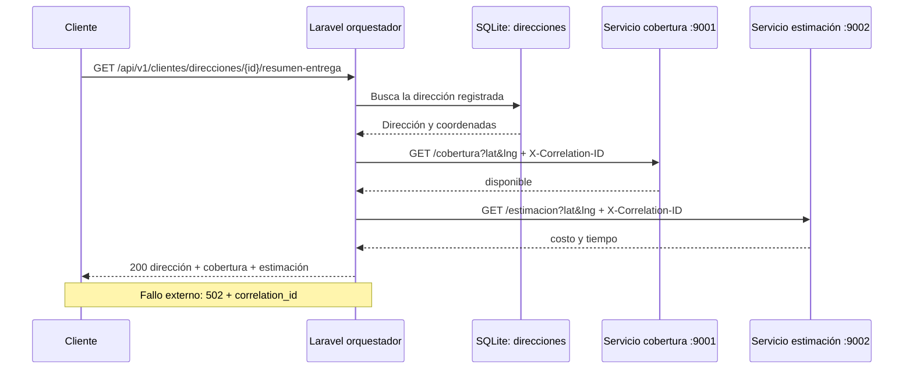

# Práctica 3.3 – Orquestación de un resumen de entrega

## Relación con el proyecto

Esta práctica continúa el registro y la normalización de direcciones de entrega de las prácticas 2.2 y 2.3. El cliente registra una dirección mediante `POST /api/v1/clientes/direcciones` o su variante `/checkout`. Después, `GET /api/v1/clientes/direcciones/{id}/resumen-entrega` recupera esa dirección de SQLite y consulta dos servicios de prueba: cobertura y estimación de costo y tiempo. Laravel compone la respuesta y mantiene un `X-Correlation-ID` común en la petición, las consultas externas, la respuesta y los logs.

Los servicios de cobertura y estimación tienen reglas de laboratorio definidas en `servicios/router.php`. Reciben las coordenadas de la dirección registrada y devuelven los datos que Laravel necesita para construir el resumen de entrega.

## Flujo de orquestación del proyecto

Al consultar el resumen, Laravel busca la dirección en SQLite y envía sus coordenadas a los servicios HTTP de cobertura y estimación, ejecutados por separado en los puertos 9001 y 9002. Comprueba ambas respuestas y compone un JSON con `direccion`, `cobertura`, `estimacion` y `correlation_id`. Cada consulta tiene un límite de 3 segundos. Si un servicio falla, Laravel registra el motivo y devuelve **502** con un mensaje controlado, sin trazas. El mismo `X-Correlation-ID` permite seguir la petición entre los tres procesos.

## Componentes y contrato

| Componente | Función |
| --- | --- |
| `app/Models/DireccionEntrega.php` | Recupera la dirección registrada en las prácticas anteriores. |
| `app/Http/Controllers/Api/ResumenEntregaController.php` | Consulta ambos servicios con timeout de 3 segundos y compone el resumen. |
| `app/Http/Middleware/AsegurarCorrelationId.php` | Propaga o genera `X-Correlation-ID` y lo incorpora al contexto de logs. |
| `servicios/router.php` | Simula cobertura en el puerto 9001 y estimación en el 9002, como procesos independientes. |
| `config/services.php` | Configura `SERVICIO_COBERTURA_URL` y `SERVICIO_ESTIMACION_URL`. |
| `tests/Feature/ResumenEntregaTest.php` | Comprueba la integración y los casos de error con servicios simulados. |

La dirección debe existir y tener `lat` y `lng`. Una dirección inexistente devuelve **404**; una dirección sin coordenadas devuelve **422** sin consultar los servicios. Si alguno no responde, devuelve HTTP 500 o entrega datos incompletos, el orquestador devuelve **502** con un mensaje controlado y el `correlation_id`. El detalle técnico queda solo en el log.

Una consulta correcta devuelve **200** con `data.direccion` (el mismo contrato de `DireccionEntregaResource`), `data.cobertura.disponible`, `data.estimacion` y `data.correlation_id`. Cuando no hay cobertura, `data.estimacion` es `null`, aunque ambos servicios hayan sido consultados.

## Preparar el laboratorio

Desde la raíz del repositorio, comprueba que `.env` use `DB_CONNECTION=sqlite`, que `database/database.sqlite` exista y ejecuta las migraciones si todavía no lo hiciste:

```powershell
if (-not (Test-Path 'database/database.sqlite')) { New-Item 'database/database.sqlite' -ItemType File | Out-Null }
php artisan config:clear --no-interaction
php artisan migrate --no-interaction
```

Las peticiones manuales de Postman usarán esa SQLite local y crearán una dirección ficticia. Las pruebas automatizadas, en cambio, usan SQLite en memoria y no alteran ese archivo.

Abre **tres terminales** en la raíz del proyecto y déjalas abiertas mientras pruebas. Si alguno de los puertos ya está en uso, libera ese puerto antes de empezar.

```powershell
# Terminal 1: servicio de cobertura, puerto 9001
$env:SERVICIO_TIPO='cobertura'; php -S 127.0.0.1:9001 servicios/router.php
```

```powershell
# Terminal 2: servicio de estimación, puerto 9002
$env:SERVICIO_TIPO='estimacion'; php -S 127.0.0.1:9002 servicios/router.php
```

```powershell
# Terminal 3: orquestador Laravel, puerto 8000
php artisan serve --host=127.0.0.1 --port=8000 --no-interaction
```

## Preparar la dirección en Postman

1. Crea una petición **POST** a `http://127.0.0.1:8000/api/v1/clientes/direcciones`. En **Headers**, añade `Content-Type: application/json` y `Accept: application/json`; en **Body → raw → JSON**, pega:

```json
{"etiqueta":"Casa de prueba","direccion":"Calle Ficticia 123","lat":-0.9580285,"lng":-80.6384797}
```

2. Pulsa **Send** y comprueba **201 Created**. Copia el número de `data.id`; en los pasos siguientes, **sustituye `{id}` por ese número** (sin llaves). No supongas que siempre será `1`.
3. Crea una petición **GET** a `http://127.0.0.1:8000/api/v1/clientes/direcciones/{id}/resumen-entrega`. En **Headers**, añade `Accept: application/json` y `X-Correlation-ID: entrega-001`. Déjala guardada para repetir las pruebas.

La cobertura simulada considera disponible el rectángulo de latitud −1.1 a −0.8 y longitud −80.8 a −80.5. La estimación simulada usa costo 2.5 y 30 minutos en la zona central; fuera de ella usa 4.0 y 45 minutos. Estos valores son únicamente datos de demostración.

## Capturas para el DOCX

Haz las pruebas en este orden, usando siempre el GET de la dirección **11** que ya creaste. Las capturas **1 y 3 son de Postman**: muestran el resultado exitoso y el fallo. La **captura 4 es del archivo de registro abierto en VS Code**, porque ese detalle interno no aparece en Postman. Las capturas 2 y 5 también son de Postman; 6 y 7 son comprobaciones adicionales de los servicios y las pruebas. Si solo necesitas las evidencias solicitadas en la actividad, prioriza 1, 3 y 4.

1. **Captura 1 – resultado exitoso 200 (obligatoria).** Con los tres procesos activos, envía el GET guardado. Comprueba `data.direccion.id` igual al ID copiado, `data.cobertura.disponible: true`, `data.estimacion.costo_estimado: 2.5`, `data.estimacion.tiempo_minutos: 30` y `data.correlation_id: entrega-001`. La respuesta debe incluir también `X-Correlation-ID: entrega-001` en **Headers**. Captura Postman mostrando URL, **200 OK** y JSON. Si quieres mostrar el registro previo, toma aparte una captura del POST **201**.
2. **Captura 2 – ID generado (complementaria).** Desactiva el header `X-Correlation-ID` en el GET y envíalo de nuevo. Comprueba que `data.correlation_id` contiene un UUID; en la pestaña **Headers** de la respuesta verifica que `X-Correlation-ID` tiene el mismo valor. Captura el JSON y, si quieres demostrar también la cabecera, toma una segunda imagen de esa pestaña.
3. **Captura 3 – servicio caído y 502 (obligatoria).** En la terminal 2 pulsa **Ctrl+C** para detener solo estimación; deja activos cobertura y Laravel. Activa de nuevo el header del GET y cámbialo a `X-Correlation-ID: entrega-fallo-001`. Envía la petición. Debe devolver **502 Bad Gateway** con `mensaje` y `correlation_id: entrega-fallo-001`, sin `trace`, `exception`, `file` ni `line`. Captura URL, estado y JSON.
4. **Captura 4 – error en el log (obligatoria).** **No enciendas todavía la terminal 2.** Después de la captura 3, cobertura (terminal 1) y Laravel (terminal 3) siguen activos; estimación (terminal 2) sigue detenida. Tampoco vuelvas a enviar el GET: el fallo ya quedó registrado. En VS Code abre `storage/logs/laravel.log` desde el explorador de archivos y pulsa **Ctrl+F**. Busca `entrega-fallo-001`. En la coincidencia más reciente verás `local.ERROR: Servicio de entrega no disponible o sin respuesta`, `"correlation_id":"entrega-fallo-001"`, `"servicio":"estimacion"` y `"direccion_id":11`. **Captura esa línea visible en el editor de VS Code.** Este es el registro del error que produjo el **502** de Postman en la captura 3. Si no encuentras la línea, conserva la terminal 2 detenida y repite solo el GET de la captura 3 con ese mismo `X-Correlation-ID`.
5. **Captura 5 – timeout (complementaria, en Postman).** Ahora sí vuelve a usar la terminal 2, que sigue detenida. Mantén cobertura (terminal 1) y Laravel (terminal 3) activos. En la terminal 2 ejecuta:

   ```powershell
   $env:SERVICIO_TIPO='estimacion'; $env:SERVICIO_MODO='lento'; php -S 127.0.0.1:9002 servicios/router.php
   ```

   En Postman usa el mismo GET de la dirección **11**, cambia el header a `X-Correlation-ID: entrega-lento-001` y pulsa **Send**. El servicio tarda 5 segundos y Laravel corta la espera a los 3 segundos: verás **502**, `mensaje` y `correlation_id: entrega-lento-001`. **Captura Postman mostrando URL, 502, JSON y tiempo de respuesta.** Al terminar, detén solo la terminal 2 con **Ctrl+C**; las terminales 1 y 3 permanecen activas.
6. **Captura 6 – mismo ID en los dos servicios (complementaria).** Después de la captura 5, la terminal 2 vuelve a estar detenida. Inicia allí estimación en modo normal:

   ```powershell
   Remove-Item Env:SERVICIO_MODO -ErrorAction SilentlyContinue
   $env:SERVICIO_TIPO='estimacion'; php -S 127.0.0.1:9002 servicios/router.php
   ```

   En Postman cambia el header a `X-Correlation-ID: entrega-rastreo-001` y pulsa **Send** en el GET de la dirección **11**. Debes recibir **200**. Para verificar que los dos servicios recibieron el ID, mira las líneas más recientes de sus terminales: una contiene `[cobertura] /cobertura correlation_id=entrega-rastreo-001` y la otra `[estimacion] /estimacion correlation_id=entrega-rastreo-001`. Esta comprobación **se captura en las dos terminales**, porque Postman solo muestra la respuesta del orquestador. Puedes omitirla si tu entrega solo requiere las evidencias principales.
7. **Captura 7 – pruebas automatizadas (complementaria).** Esta comprobación es de **la salida de PHPUnit, no de Postman**. Abre otra terminal en la raíz del proyecto y ejecuta:

   ```powershell
   php artisan test --compact tests/Feature/ResumenEntregaTest.php
   ```

   Cuando termine, captura el comando y la línea final con 8 pruebas y 38 aserciones correctas. Las pruebas usan SQLite en memoria y `Http::fake()`; no dependen de que los tres servidores estén activos. Puedes omitir esta captura si tu entrega solo requiere las evidencias principales.

Para probar además un error HTTP **500** sin detener un servicio, reinicia la terminal 2 con `$env:SERVICIO_TIPO='estimacion'; $env:SERVICIO_MODO='error'; php -S 127.0.0.1:9002 servicios/router.php` y repite el GET. El orquestador debe responder **502**. Al terminar, limpia el modo con `Remove-Item Env:SERVICIO_MODO -ErrorAction SilentlyContinue`.

## Comparación que debes explicar

| Observación | Flujo normal | Estimación caída o lenta |
| --- | --- | --- |
| HTTP del orquestador | 200 | 502 |
| JSON | `data.direccion`, `data.cobertura`, `data.estimacion`, `data.correlation_id` | `mensaje` y `correlation_id`, sin trazas |
| `X-Correlation-ID` | Coincide en cliente, ambos servicios y respuesta | Coincide en cliente, respuesta y log del error |
| Detalle técnico | No aplica | Solo en `storage/logs/laravel.log` |

Una dirección inexistente devuelve **404** y una dirección sin coordenadas **422** antes de llamar a los servicios. El **502** documenta el comportamiento del orquestador cuando falla una capacidad externa.

## Preparar la entrega

Continúa en el documento existente `docs/Practica_3_3.docx`. Pega la captura 4 del registro junto a las capturas 1 y 3 de Postman. Las capturas 2 y 5 a 7 son complementarias; si no las incluyes, elimina sus recuadros vacíos antes de exportar el DOCX como PDF. Entrega ese PDF junto con el enlace del repositorio, o ambos dentro de un ZIP, según indique el docente. La carpeta `docs/` está excluida de Git, por lo que debes adjuntar el PDF por separado si entregas un enlace al repositorio.

## Pruebas automatizadas

```powershell
php artisan test --compact tests/Feature/ResumenEntregaTest.php
```

Las pruebas usan SQLite en memoria y `Http::fake()`: no modifican la base local ni requieren levantar los servicios de prueba.

## Secuencia


